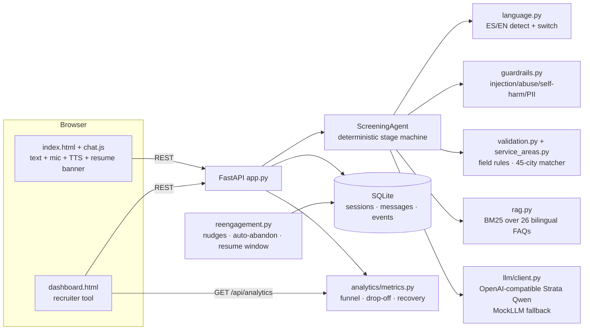
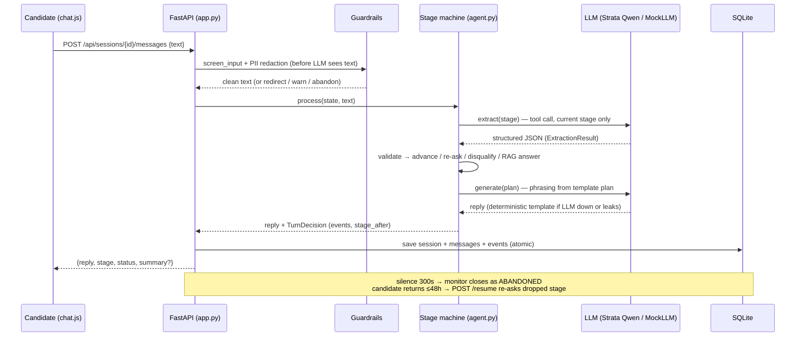

# Architecture

## Component map

## Request flow (one candidate turn)

1. `POST /api/sessions/{id}/messages` → guardrails screen the raw text (injection/abuse/self-harm/length) **before** the LLM sees it; PII redacted.
2. Language resolved per message (follows the candidate; MIXED keeps conversation language).
3. Stage machine routes the turn: FAQ question → RAG answer (BM25, FAQ id logged); otherwise → LLM **tool call** extracts structured data for the *current stage only*.
4. Validation normalizes/validates each field (service-area match, availability/schedule keyword maps, date window). Invalid → re-ask with alternate phrasing; 3 strikes → accept-with-flag.
5. Reply is phrased by the LLM from a plan; if the LLM is unavailable, **templates** guarantee the conversation never breaks (`MockLLM` for tests/demos).
6. Turn persisted atomically: session row + message rows + events (`stage_advance`, `reask`, `rag_answer`, `guardrail`, `disqualify`…). User text stored redacted.

## System design (one candidate turn)

## Why this design (key trade-offs)

- **Deterministic flow + LLM extraction (hybrid).** The rubric's "structured JSON extraction" is done with OpenAI-style tool calling, but the *decision* to advance/re-ask/disqualify lives in code. Auditable, never hallucinated, works offline.
- **Local model (Strata/llama.cpp, quantized Qwen).** At 1k–10k conversations/week, hosted-API cost and data residency (Spain GDPR/LOPD, Mexico) dominate. Quantized-model quality is compensated by deterministic validation and our own guardrails. Swap to any OpenAI-compatible endpoint via `.env`.
- **BM25 RAG instead of embeddings.** 26 FAQ docs don't need vector search; BM25 is deterministic, offline, and logs exactly which FAQ answered a question.
- **SQLite, not Postgres.** Single-file, zero-ops for a demo; the storage layer is a thin module — swapping to Postgres is one file. Sessions are restored on restart so candidates mid-conversation are never orphaned.
- **Known matcher quirks (documented):** zone matching can shadow city names ("Salamanca" → Madrid zone; "León" → MX via "Valle de León"). Ambiguity triggers a clarifying question; tests pin this behavior.

## Storage schema

- `sessions(id, status, stage, language, source, started_at, last_ts, data_json, summary_json, flags, notes, given_up, languages, rag_hits, reengage_attempts)`
- `messages(session_id, role, content, ts, stage, delivered)` — `delivered=False` for queued re-engagement nudges
- `events(session_id, type, payload_json, ts, stage)` — full audit trail per turn

## API

| Endpoint | Purpose |
|---|---|
| `POST /api/sessions` | create session (source: chat) |
| `POST /api/sessions/{id}/messages` | candidate turn → reply + decision |
| `GET /api/sessions/{id}/pending` | poll for re-engagement nudges |
| `POST /api/sessions/{id}/end` | candidate ends conversation |
| `POST /api/sessions/{id}/resume` | reopen an abandoned session (≤48h); final decisions → 409, expired → 410 |
| `GET /api/sessions?status=&qualified=&q=` | recruiter list/search |
| `GET /api/sessions/{id}` | full transcript + events + summary JSON |
| `GET /api/analytics` | funnel, completion/qualified rates, drop-off by stage, language mix, nudge recovery |
