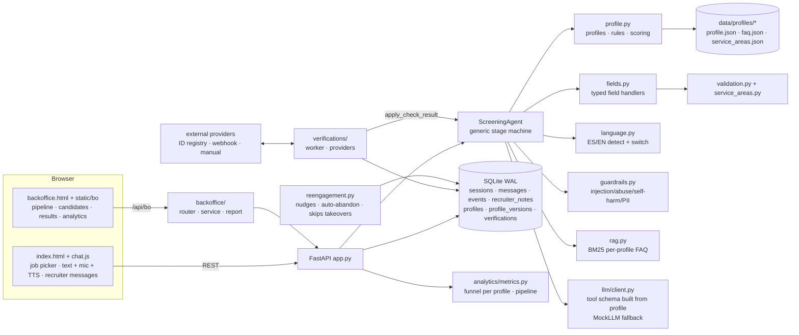
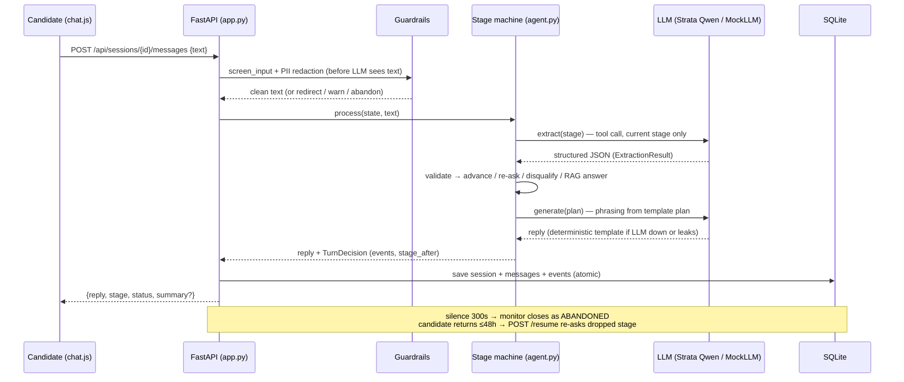

# Architecture

## Component map

## Generic engine + screening profiles

The agent no longer knows any job. `ScreeningAgent` executes the **profile** of each session (`session.profile_id`):

- **Flow**: `intro → <profile questions in order> → review → qualified | disqualified | abandoned`. A stage is a plain string: a lifecycle constant or a question id.
- **Extraction**: `llm.extract(history, stage, today, profile=…)`. The OpenAI tool schema is generated from the profile's questions (each field handler contributes its JSON-schema properties), and the reply persona comes from `profile.persona`.
- **Validation**: each question's typed handler (`fields.py`) validates the model's output and provides a deterministic raw-text parser. That parser is the fallback when the model returns nothing usable, and it powers `MockLLM`.
- **Decisions**: `profile.knockout()`, error-triggered rules, flag rules (`review: true` routes to human review), `profile.is_qualified()`, `profile.score()`.
- **Knowledge**: per-profile FAQ index and coverage areas, loaded lazily from the profile folder.

See `docs/screening_profiles.md` for the profile format.

Profiles are stored in the database as immutable **revisions** (seeded from `backend/data/profiles/*`, edited as drafts in the backoffice, published by recruiters). The registry keeps the latest revision of each process and loads older ones on demand: `agent.profile(state)` resolves `(profile_id, profile_revision)`, so a session always runs the rules it started with.

## External checks (asynchronous)

A turn that answers a check's trigger question adds a request to `TurnDecision.check_requests` (never serialised). `persist_turn` writes it to the `verifications` outbox, so no network call happens in the request path. The background worker (`verifications/service.py`) dispatches to the provider, polls, retries, enforces deadlines and, on a definitive answer, calls `ScreeningAgent.apply_check_result`. That re-runs the rules: a knockout closes the screening, a `verifying` session gets its final decision, and the candidate is told on their channel. Webhook providers answer on `POST /api/verifications/{id}/callback` (HMAC-signed). A per-session lock in `SessionStore` serialises worker updates with candidate turns and recruiter actions. See `docs/external_checks.md`.

## Request flow (one candidate turn)

1. `POST /api/sessions/{id}/messages` → guardrails screen the raw text (injection/abuse/self-harm/length) **before** the LLM sees it; PII redacted.
2. Language resolved per message (follows the candidate; MIXED keeps conversation language).
3. Stage machine routes the turn: FAQ question → RAG answer (BM25, FAQ id logged); otherwise → LLM **tool call** extracts structured data for the *current stage only*.
4. Validation normalizes/validates each field (service-area match, availability/schedule keyword maps, date window). Invalid → re-ask with alternate phrasing; 3 strikes → accept-with-flag.
5. Reply is phrased by the LLM from a plan; if the LLM is unavailable, **templates** guarantee the conversation never breaks (`MockLLM` for tests/demos).
6. Turn persisted atomically: session row + message rows + events (`stage_advance`, `reask`, `rag_answer`, `guardrail`, `disqualify`…). User text stored redacted.

## System design (one candidate turn)

## Why this design (key trade-offs)

- **Deterministic flow + LLM extraction (hybrid).** The rubric's "structured JSON extraction" is done with OpenAI-style tool calling, but the *decision* to advance/re-ask/disqualify lives in code. Auditable, never hallucinated, works offline.
- **Local model (Strata/llama.cpp, quantized Qwen).** At 1k–10k conversations/week, hosted-API cost and data residency (Spain GDPR/LOPD, Mexico) dominate. Quantized-model quality is compensated by deterministic validation and our own guardrails. Swap to any OpenAI-compatible endpoint via `.env`.
- **Profiles as data, engine as code.** Business rules change per client and per job; the code that enforces them (validation, guardrails, flow, persistence) doesn't. A JSON profile validated at startup is reviewable by non-engineers and testable with `MockLLM`.
- **BM25 RAG instead of embeddings.** A few dozen FAQ docs per profile don't need vector search; BM25 is deterministic, offline, and logs exactly which FAQ answered a question.
- **SQLite, not Postgres.** Single-file, zero-ops for a demo; the storage layer is a thin module — swapping to Postgres is one file. Sessions are restored on restart so candidates mid-conversation are never orphaned.
- **Known matcher quirks (documented):** zone matching can shadow city names ("Salamanca" → Madrid zone; "León" → MX via "Valle de León"). Ambiguity triggers a clarifying question; tests pin this behavior.

## Storage schema

- `sessions(id, profile_id, status, stage, language, source, contact, started_at, last_ts, updated_at, data_json, summary_json, flags, notes, given_up, languages, rag_hits, state_json, reengage_attempts, …)`: agent-owned columns, written by `save_session`. `state_json` keeps attempts, abuse count and completed stages, so a restart never resets a candidate's re-ask budget.
- Backoffice columns on the same row: `display_name, display_city, score` (derived per profile on every save), `search_text` (accent-free haystack), and recruiter-owned `pipeline_stage, pipeline_manual, assignee, tags_json, interview_at, bot_paused`. `save_session` never overwrites a recruiter's manual pipeline move.
- `messages(session_id, role, content, ts, stage, delivered, author)`: roles `user`, `assistant`, `recruiter`. `delivered=0` = queued for the web chat (nudges, recruiter messages, hand-back/reopen questions).
- `events(session_id, type, payload_json, ts, stage)`: full audit trail (agent turns + recruiter actions with `by`).
- `recruiter_notes(id, session_id, author, body, ts)`.
- `pipeline_stages(id, label, color, position, created_at)`: the recruiter-editable hiring stages, seeded with the defaults from `backend/pipeline.py`. `screening`, `review`, `qualified` and `rejected` are system stages (used by the automatic placement) and can't be deleted.
- `profiles(id, latest_revision, seed_hash, draft_json, draft_revision, …)` and `profile_versions(profile_id, revision, data_json, published_at, published_by, note)`; `sessions.profile_revision` pins each session.
- `verifications(id, session_id, check_id, provider, status, payload_json, result_detail, reference, attempts, due_at, deadline_at, completed_at, decided_by)`: the outbox of external checks. `payload_json` (which may hold a full ID number) is purged once the check has a definitive answer.

Migrations are additive (`_ADDED_COLUMNS`); databases from the courier-only release are upgraded in place and backfilled (profile `delivery_courier`, pipeline stage, name, score). SQLite runs in WAL mode, so backoffice reads never block candidate turns.

## API

| Endpoint | Purpose |
|---|---|
| `GET /api/profiles` | active processes for the job picker (id, company, role, summary, question labels) |
| `POST /api/sessions` | create session `{profile_id?, language?}` (default profile if omitted) |
| `POST /api/sessions/{id}/messages` | candidate turn → reply + decision (`reply` empty and `paused: true` during a human takeover) |
| `GET /api/sessions/{id}/pending` | queued messages (nudges, recruiter messages) + live `{status, stage, bot_paused}` |
| `POST /api/sessions/{id}/end` | candidate ends conversation |
| `POST /api/sessions/{id}/resume` | reopen an abandoned session (≤48h); final decisions → 409, expired → 410 |
| `GET /api/sessions/{id}` | candidate-safe transcript + summary (no recruiter data) |
| `GET /api/sessions?status=&qualified=&q=&profile_id=` | recruiter list (auth) |
| `GET /api/analytics?profile_id=` | metrics (auth) |
| `/api/bo/*` | recruiter backoffice API, including process CRUD: see `docs/backoffice.md` |
| `POST /api/verifications/{id}/callback` | signed answer of a webhook verification provider |
| `/backoffice` | recruiter portal (`/dashboard` redirects to its analytics view) |
