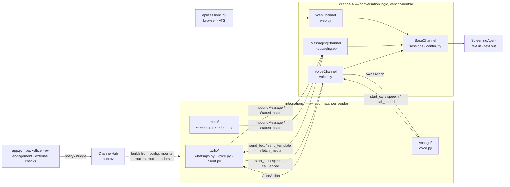

# Channel architecture

How candidates reach the screening agent over the web chat, WhatsApp and the phone, and how
providers (Twilio, Meta, Vonage…) plug in. Goal: **provider logic never touches
the agent, channels and providers are swapped by configuration, and every
provider is tested end to end locally by the same tests.**

## Review: where we started

A review of the code after the first channel iterations found the agent core
clean (text in, text out), but provider specifics leaking everywhere around it:

| # | Coupling | Where it was | Now |
|---|---|---|---|
| 1 | Webhook routes, parsing, signature checks and reply rendering of every provider written by hand in the app (~170 lines) | `app.py` | Each provider adapter owns its routes; the app mounts what the hub gives it (`app.py` has no provider import, enforced by a test) |
| 2 | **Voice welded to Twilio**: TwiML built inside the conversation logic | `channels/voice.py` | `VoiceChannel` returns neutral `VoiceAction`s; adapters render them (TwiML, NCCO). Proven with a second provider (Vonage) |
| 3 | The "neutral" WhatsApp channel rendered TwiML and branched on `provider.name == "twilio"` / `!= "meta"` | `channels/messaging.py` | `MessagingChannel` asks the provider to render (`render_webhook_reply`) and reads capabilities; no provider names |
| 4 | WhatsApp's 24h window in the agent's `SessionState` (`wa_inbound_at`, `whatsapp_window_open()`) | `screening/agent.py` | Opaque `channel_state` owned by each channel; old sessions migrated on load |
| 5 | Outbound pushes hard-wired to WhatsApp | `app.py` notifiers, `db.PUSH_CHANNEL`, `candidate.js` | `ChannelHub.notify/nudge` route to any push-capable channel the candidate used; the delivering channel is recorded; the backoffice reads capabilities |
| 6 | Provider choice = `if/else`; voice not selectable | `app.py` | Registry + `WHATSAPP_PROVIDER` / `VOICE_PROVIDER` (`none` turns a channel off) |
| 7 | Simulator dispatching on `== "meta"`; test harness poking provider internals | `simulators/`, `simulators/testing.py` | Voice provider plugins behind one `BaseCall` API; one test seam (`hub.use_http`) |

## Terminology

| Term | Means | Lives in |
|---|---|---|
| **Channel** | How a candidate talks to us, as the conversation sees it: `web`, `whatsapp`, `voice`. Owns sessions, continuity, ordering, takeover. Vendor-neutral. | `backend/channels/` |
| **Provider** | A vendor that carries a channel (Twilio, Meta, Vonage). Selected per channel by configuration. | `backend/integrations/<vendor>/` |
| **Client** | The HTTP client of one vendor API (`TwilioClient`, `MetaClient`, `OpenAICompatibleTranscriber`). Knows URLs, auth, error codes. | `integrations/<vendor>/client.py` |
| **Adapter** | The glue between a provider and a channel: parses webhooks into neutral contracts, renders replies (TwiML, NCCO), checks signatures, exposes a router. One file per channel it serves (`twilio/whatsapp.py`, `twilio/voice.py`). | `integrations/<vendor>/<channel>.py` |
| **Service** | A capability that is not a channel (speech-to-text for voice notes). | `integrations/speech/` |

## Folder structure

```
backend/
  channels/                 # vendor-neutral: what a conversation on each channel means
    contracts.py            #   InboundMessage, StatusUpdate, MessagingClient, Transcriber…
    base.py                 #   BaseChannel: sessions by contact, continuity, transcript
    web.py                  #   WebChannel: browser chat and ATS sessions (no provider)
    messaging.py            #   MessagingChannel: WhatsApp (or any phone-number messaging)
    voice.py                #   VoiceChannel + VoiceAction
    hub.py                  #   ChannelHub: builds channels + adapters from config, routes pushes
  integrations/             # vendor-specific: wire formats and HTTP clients
    registry.py             #   ProviderSpec, REGISTRY, register(), providers(kind)
    twilio/   client.py  webhooks.py  whatsapp.py  voice.py
    meta/     client.py  whatsapp.py
    vonage/   voice.py
    speech/   client.py     #   transcription service (voice notes), not a channel
  api/sessions.py           # HTTP transport of the web channel (/api/sessions…)
  app.py                    # mounts the hub's routers; imports no vendor
simulators/                 # one plugin per vendor, same names as integrations/
  core.py                   #   ChannelSimulator, Phone, BaseCall, faults, provider lists
  twilio.py  meta.py  vonage.py  speech.py  twiml.py
  server.py  runner.py  testing.py  __main__.py
```

A vendor never imports another vendor, and nothing outside `integrations/`
imports a vendor; `tests/integration/channels/test_architecture.py` enforces both.

## The layers



| Layer | Knows | Never knows |
|---|---|---|
| **Agent** (`screening/`) | questions, rules, language, text | channels, providers |
| **Channels** (`channels/web.py`, `messaging.py`, `voice.py`, `base.py`) | sessions (by id for web, by phone number for the others), channel switches, voice notes, media, service windows and templates, delivery registry and order, takeover, silence on calls | a vendor's wire format, SDK or name |
| **Adapters + clients** (`integrations/<vendor>/`) | their webhooks, signatures, payloads, rendering (TwiML, NCCO, Graph API), error codes | screening logic |
| **Hub** (`channels/hub.py`) | which providers run, how to reach a candidate | payloads, screening logic |
| **App** (`app.py`, `api/`) | the hub, the web channel | providers |

### The web channel

`WebChannel` (`channels/web.py`) is the browser chat and the entry point for
integrations that relay their own channel (an ATS: `source="ats"`). It has no
provider and no webhooks: `api/sessions.py` is its HTTP transport (`POST
/api/sessions`, `/{id}/messages`, `/{id}/pending`, `/{id}/resume`, `/{id}/end`).
It starts sessions per process, reopens abandoned ones inside the resume window,
refuses to resume a final decision, and records turns with `channel = "web"`
(or the integration's `source`), so switches between web, WhatsApp and voice
land in one transcript. Replies travel in the HTTP answer; anything sent later
(a recruiter's message) is picked up by the browser polling `/pending`. It
can't push to a candidate who has left (`describe()["web"]["push"] is False`),
so the hub never picks it for notifications or nudges.

### The neutral contracts (`channels/contracts.py`, `channels/voice.py`)

| Contract | Direction | Fields |
|---|---|---|
| `InboundMessage` | provider → messaging channel | `contact`, `text`, `media: [MediaRef(mime_type, url\|id, voice)]`, `message_id` (de-duplication), `profile_name`, `kind` (location, sticker…) |
| `StatusUpdate` | provider → messaging channel | `external_id`, `status` (sent/delivered/read/failed), `error_code` |
| `MessagingClient` | messaging channel → provider | `name`, `kind`, `replies_in_webhook`, `window_error_codes`, `render_webhook_reply`, `send_text`, `send_template`, `template_configured`, `fetch_media`, `mark_read`, `use_http` |
| voice events | provider → `VoiceChannel` | `start_call(contact, call_id)`, `speech(session_id, text, retries, confidence, call_id)` (empty text = silence), `call_ended(call_id, status)` |
| `VoiceAction` | `VoiceChannel` → provider | `text` / `speech`, `locale`, `listen` (or hang up), `session_id`, `retries` |

Capabilities replace provider names. A provider that can't carry replies in the
webhook answer (Meta) gets them sent through its API. A provider without a
service window (empty `window_error_codes`) never triggers templates.

### Adapter interface (`integrations/registry.py`)

```python
name: str                # "twilio", "meta", "vonage"
kind: str                # "whatsapp" | "voice"
channel                  # the MessagingChannel / VoiceChannel it drives
configured: bool
router() -> APIRouter    # its webhooks, signature checks included
extra_routers() -> {key: factory(hub)}   # optional: routes shared by adapters (Twilio's bare-host POST /)
use_http(client)         # test seam: outbound HTTP through an httpx-compatible client
```

### Configuration

| Setting | Values |
|---|---|
| `WHATSAPP_PROVIDER` | `twilio` (default), `meta`, `none` |
| `VOICE_PROVIDER` | `twilio` (default), `vonage`, `none` |
| `WHATSAPP_PROFILE` / `VOICE_PROFILE` | the recruiting process each line runs |

Swapping a provider changes nothing else. Sessions, transcripts, channel switches,
the backoffice and analytics are keyed by *channel* (`whatsapp`, `voice`), not by
provider. The provider is recorded in message metadata and in the delivery registry.

## Adding a provider (checklist)

Example: WhatsApp through another vendor, or SMS/voice through another carrier.

1. **Client/adapter** in `backend/integrations/<vendor>/`: `client.py` for its
   HTTP API, one file per channel it serves (`whatsapp.py`, `voice.py`). Parse its
   webhooks into `InboundMessage` / `StatusUpdate` (messaging) or voice events;
   render `VoiceAction` (voice); implement `MessagingClient` for sending;
   verify its signatures; expose `router()` and `use_http()`.
2. **Register** it: `register(ProviderSpec(kind, name, build, summary))` in
   `integrations/registry.py`, and add its settings to `config.py` / `.env.example`.
3. **Simulator plugin**: for voice, a `BaseCall` subclass that executes the
   vendor's call-control language (see `simulators/vonage.py`, ~180 lines);
   for messaging, an inbound sender + API handler (see `simulators/meta.py`).
   Add the name to `MESSAGING_PROVIDERS` / `VOICE_PROVIDERS` in `simulators/core.py` and its settings to
   `simulators/testing.py:app_settings` / `simulators/runner.py:app_env`.
4. **Done.** Every contract test takes the provider matrix from the registry
   (`wa_provider`, `voice_provider`, `live`, `live_voice`), so the screening
   stories, channel switches, registry parity, voice notes and robustness tests
   run against the new provider with no edits. `tests/integration/channels/test_architecture.py`
   fails if a registered provider has no simulator plugin or leaks into the core.
   Add adapter-level tests for its specifics (signature scheme, payload quirks),
   like `tests/unit/integrations/test_vonage_voice.py` and
   `tests/integration/channels/test_vonage_webhooks.py`.

`tests/integration/channels/test_architecture.py::test_a_new_provider_plugs_in_without_touching_the_core`
is an executable version of this checklist. A toy messaging provider, written
inside the test, is registered and screens a candidate, deduplicates retries
and receives a recruiter's message.

## Adding a channel kind (SMS, Telegram, web push…)

`MessagingChannel` is not WhatsApp-specific: its name comes from the provider's
`kind`, and WhatsApp rules are capabilities (service window, templates, voice
notes). An SMS provider (`kind = "sms"`, no window, no media) would reuse it
as is; add a label in `hub.KIND_LABELS` and a `sms_provider` / `SMS_PROFILE`
selection. Channels that do not identify people by phone number (Telegram,
web) need an identity mapping before channel continuity can link them, because
sessions are matched by `contact` (E.164).

## Testing strategy

| Layer | Where | Runs against |
|---|---|---|
| Channel logic (no HTTP) | `tests/unit/channels/` (web, messaging, continuity, takeover) | fakes |
| Adapter / client specifics | `tests/unit/integrations/` (Twilio client, TwiML, Vonage NCCO and JWT) | one provider |
| Simulator fidelity | `tests/unit/simulators/` | the simulator vs. a capture app |
| **Channel contract** (in-process app + simulator) | `tests/integration/channels/` (`test_stories.py`, `test_conversation_registry.py`, `test_voice_notes.py`, `test_robustness.py`, webhooks per vendor) | **every registered provider** (and WhatsApp × voice combinations for channel switches) |
| **End to end** (live servers, browser) | `tests/e2e/channels/` | every registered provider (`live`, `live_voice`), plus a stack without Twilio |
| Architecture rules | `tests/integration/channels/test_architecture.py` | imports, registry ↔ simulator ↔ test matrix, adapter interface, configuration, a toy provider |

## Known limits / next steps

- **Web sessions carry no phone number by default.** Continuity matches
  undecided sessions by contact (E.164), so a web session joins a later WhatsApp
  or phone conversation only when it was created with the candidate's number (a
  recruiter referral). A candidate who opens the chat anonymously and later writes
  on WhatsApp starts a second screening.
- **One provider per channel kind at a time.** Two WhatsApp numbers on two
  providers (or two processes on two numbers) would need the hub to key
  adapters by number, not by kind.
- **Vonage Voice is the only non-Twilio voice provider.** Its behaviour comes from
  the Voice API documentation and is reproduced by the simulator. Verify it with a
  real Vonage application before production, like the others.
