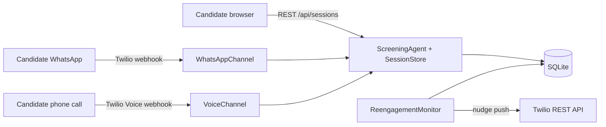

# WhatsApp & Voice channels (Twilio)

The screening agent is channel-agnostic: text in, text out. The web chat was the
first transport; `backend/channels/` adds two more on top of the exact same
`ScreeningAgent` + `SessionStore` pair, so guardrails, validation, RAG,
re-engagement, resume and analytics behave identically everywhere.

## Architecture

| Piece | Responsibility |
|---|---|
| `channels/twilio_provider.py` | The only code that touches the Twilio SDK: outbound WhatsApp sends + `X-Twilio-Signature` webhook validation. Injected everywhere, trivially mockable. |
| `channels/base.py` | Contact→session lifecycle shared by both channels (continue active / resume abandoned within `RESUME_WINDOW_HOURS` / start fresh after final decisions), plus text utilities (message chunking, voice sanitising). |
| `channels/whatsapp.py` | Inbound webhook → agent turn → TwiML `<Message>` reply. Outbound nudges via Twilio REST. |
| `channels/voice.py` | The call is a TwiML loop: `<Say>` the agent's reply, `<Gather input="speech">` the answer, POST the transcript back. Twilio does STT/TTS; the agent only ever sees text. |
| `session_store.py` | In-memory registry backed by SQLite, now also addressable by channel identity (`source` + `contact` phone number). Survives restarts. |

### Session identity

Web sessions are addressed by session id; channel sessions by phone number
(`sessions.contact`, E.164, `whatsapp:` prefix stripped). One number maps to
one live screening: an active session continues, an abandoned one resumes
inside the 48h window (same rules as the web resume banner), and
qualified/disqualified stay final — a new message/call starts a fresh
conversation instead.

### WhatsApp specifics

- Replies ride the webhook response (TwiML), so the happy path needs zero REST
  calls and no extra latency.
- The first inbound message ("hola") is treated as the conversation trigger:
  it is stored for the transcript and answered with the agent's opening.
- Long replies are split on sentence boundaries (`WHATSAPP_CHAR_LIMIT`,
  default 1500 — Twilio caps WhatsApp bodies at 1600).
- **Webhook deadline.** Twilio abandons webhooks after 15s. The turn runs in a
  worker thread; if it is not done within `WHATSAPP_SYNC_TIMEOUT_SECONDS`
  (default 10) the webhook returns an empty `<Response/>` and the reply is
  pushed through the REST API when the LLM finishes. Turns for the same number
  are serialised so racing webhooks never interleave a conversation.
- **Re-engagement now pushes.** The monitor accepts a notifier callback; for
  WhatsApp sessions nudges go out through the Twilio REST API. If Twilio is
  unreachable the nudge is stored undelivered (exactly like web) and surfaces
  on the candidate's next message.
- **Templates for business-initiated messages.** WhatsApp only allows
  free-form text inside the 24h customer-service window opened by the
  candidate's last message; anything else (and everything on a template-only
  sender) must be an approved Content Template — Twilio errors **21654** /
  **63016**. Nudges try free-form first and fall back to
  `TWILIO_WHATSAPP_CONTENT_SID` with `{{1}}` = first name, `{{2}}` = agent
  name (event `whatsapp_template_fallback` is logged). Interactive replies
  cannot be templated, so the sender must allow free-form in-session messages:
  Sandbox for development, a Meta-verified sender in production.

### Voice specifics

- `<Gather input="speech" speechTimeout="auto">` with the locale following the
  candidate's language (`es-ES`/`en-US`), for both STT and TTS — mid-call
  language switching works like in chat.
- In-call silence: `VOICE_MAX_SILENCE_RETRIES` re-prompts (re-using the
  re-engagement copy), then a polite goodbye, hang-up, and the session closes
  as `abandoned(silence)` — callable back within the resume window.
- Hanging up mid-screen leaves the session active; the silence monitor closes
  it later, and calling back resumes at the pending question.
- Replies are sanitised for TTS (emoji/markdown stripped).

### Security

Every webhook validates `X-Twilio-Signature` (HMAC over the full public URL +
form params, computed with `TWILIO_AUTH_TOKEN`). Requests that fail validation
get `403` before any agent code runs. Signed against `PUBLIC_BASE_URL` when the
app sits behind a proxy/tunnel; set `TWILIO_VALIDATE_SIGNATURES=false` only for
local development.

## Twilio console setup

1. Create/configure senders and point the webhooks at your public URL
   (e.g. an ngrok tunnel in dev):

   | Twilio setting | URL |
   |---|---|
   | WhatsApp sender → "When a message comes in" | `POST {PUBLIC_BASE_URL}/api/channels/whatsapp/inbound` |
   | Phone number → "A call comes in" | `POST {PUBLIC_BASE_URL}/api/channels/voice/inbound` |
   | Phone number → "Call status changes" | `POST {PUBLIC_BASE_URL}/api/channels/voice/status` |

   The URL **must include the path** — a bare host URL shows up in the server
   log as `POST / 405`. As a safety net, `POST /` does recognise Twilio
   payloads and routes them (with a warning), but use the explicit URLs.

2. Fill in `.env`: `TWILIO_ACCOUNT_SID`, `TWILIO_AUTH_TOKEN`,
   `TWILIO_WHATSAPP_FROM` (e.g. the sandbox `whatsapp:+14155238886`) and
   `PUBLIC_BASE_URL`.

**Verify before testing:** `python scripts/check_twilio.py` prints the values
the process really uses (flagging `.env` entries shadowed by OS environment
variables — `load_dotenv` never overrides them), calls Twilio to validate the
credentials (error **20003** = token/secret does not belong to the Account
SID) and warns about trial/sender mismatches. `--send +34…` pushes a test
message through the same code path the nudges use.

**Trial accounts:** WhatsApp only works through the Sandbox
(`TWILIO_WHATSAPP_FROM=whatsapp:+14155238886`), the webhook is configured in
*Messaging → Try it out → Send a WhatsApp message → Sandbox settings*, and your
phone must have sent `join <keyword>` (sandbox sessions expire after 72h). If
messages reach the backend but nothing comes back, the Request Inspector in
*Monitor → Logs → Messaging* shows the response Twilio received and the
outbound message's error code.

No credentials? Everything still boots: inbound handling works (signature
validation off for dev), outbound nudges fall back to the undelivered queue.

## Testing

`tests/test_channels_whatsapp.py`, `tests/test_channels_voice.py`,
`tests/test_channel_webhooks.py`, `tests/test_twilio_provider.py` and
`tests/test_db_migration.py` cover both channels end to end — full qualified /
disqualified screenings, resume & expiry, silence handling, language switching,
nudge pushing, signature validation and the legacy-DB migration. All external
services are faked: `MockLLM` for the model, a fake Twilio REST client for
outbound, real TwiML/`RequestValidator` objects (pure local code) for webhook
payloads. No test opens a network connection.

## Trade-offs & next steps

- **Twilio STT/TTS over media streams**: `<Gather>`/`<Say>` is one round-trip
  per turn and zero audio infrastructure on our side; a streaming
  STT/TTS pipeline (Twilio Media Streams + Deepgram/ElevenLabs) would cut
  latency and allow barge-in — swap-in point is `VoiceChannel` only.
- **Synchronous webhook replies**: fine at pilot scale; at higher volume move
  agent turns to a queue and reply via the REST API.
- **Outbound-first outreach** (agent initiates the WhatsApp/call from an ATS
  candidate list) is a natural follow-up: `TwilioProvider` already isolates
  everything needed.
