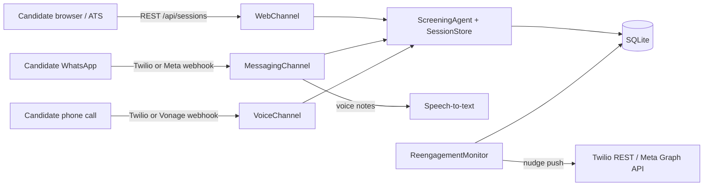

# WhatsApp & Voice channels (Twilio, Meta Cloud API)

The screening agent is channel-agnostic: text in, text out. `backend/channels/`
has three channels, web chat, WhatsApp and voice, on top of the exact same
`ScreeningAgent` + `SessionStore` pair, so guardrails, validation, RAG,
re-engagement, resume and analytics behave identically everywhere.

## Architecture

Provider logic is isolated from the channels and the agent: see
**`docs/channel_architecture.md`** (layers, neutral contracts, adding a
provider, testing strategy).

| Piece | Responsibility |
|---|---|
| `channels/web.py` + `api/sessions.py` | `WebChannel`: browser chat and ATS sessions (start per process, messages, polling for pending pushes, resume, end); `api/sessions.py` is its HTTP transport. No provider |
| `channels/messaging.py` | `MessagingChannel`, provider-neutral: inbound message → (voice note transcription) → agent turn → reply; outbound pushes with template fallback, delivery registry, order of messages, retries de-duplicated |
| `channels/voice.py` | `VoiceChannel`, provider-neutral: a call as a loop of events (`start_call`, `speech`, `call_ended`) returning `VoiceAction`s (say, listen or hang up) |
| `channels/base.py` | Contact → session lifecycle shared by all channels (continue / resume within `RESUME_WINDOW_HOURS` / start fresh), channel continuity, transcript persistence |
| `channels/hub.py` | `ChannelHub`: builds the configured providers (`WHATSAPP_PROVIDER`, `VOICE_PROVIDER`), mounts their webhooks, routes recruiter messages / check decisions / nudges to a channel the candidate can be written to |
| `integrations/twilio/` | Twilio WhatsApp (form webhooks, TwiML replies, status callbacks) and Twilio Voice (TwiML `<Gather>` loop), `X-Twilio-Signature`, the bare-host safety net |
| `integrations/meta/whatsapp.py` | Meta Cloud API webhook: handshake, `X-Hub-Signature-256`, payloads |
| `integrations/vonage/voice.py` | Vonage Voice: answer / input / event webhooks, NCCO rendering, JWT-signed webhooks |
| `integrations/twilio/client.py`, `integrations/meta/client.py` | The vendors' API clients: sends, templates, media, read receipts, signatures |
| `channels/contracts.py`, `integrations/speech/client.py` | Neutral types + `MessagingClient` interface; speech-to-text for voice notes |
| `session_store.py` (`backend/`) | In-memory registry backed by SQLite, addressable by channel identity (phone number). Survives restarts. |

### Which recruiting process?

A phone number can't show a job picker, so each channel runs one screening profile: `WHATSAPP_PROFILE` and `VOICE_PROFILE` (empty = `DEFAULT_PROFILE`). To run two processes over WhatsApp, use two Twilio senders and two deployments (or extend `MessagingChannel` to map sender → profile).

### Human takeover

When a recruiter takes over a conversation from the backoffice (`docs/backoffice.md`), the agent stays silent for that candidate:

- **WhatsApp**: recruiter messages are pushed through the provider API (same 24h-window rules; outside the window the template reopens the chat and the message waits for the candidate's answer). The candidate's replies (voice notes transcribed) are stored and answered by nobody but the recruiter. Hand-back and reopen questions are pushed too.
- **Voice**: the call takes a message ("Una persona del equipo de selección está revisando tu candidatura y te contactará pronto. Si quieres, dime tu mensaje y se lo paso."); what the caller says is stored for the recruiter, and silence ends the call without closing the screening. Recruiter messages to a phone-only candidate wait until they write on WhatsApp.
- Re-engagement nudges and silence timeouts are suspended while a recruiter owns the conversation.

### External checks on channels

When a candidate's final decision waits for an external check (`verifying`), a new WhatsApp message continues the same session: the agent answers "still verifying". The decision is **pushed** as soon as the check answers, and so is a knockout that arrives mid-conversation. Voice callers hear the holding message; the decision is kept in the transcript for the follow-up.

### Session identity

Web sessions are addressed by session id. WhatsApp and phone address a **candidate**: the
phone number is an identity key (canonical form: `+52…` for WhatsApp's `+521…`, `00` and
national numbers normalised, withheld caller IDs identify nobody), and the candidate owns
their applications (sessions). Full design: `docs/identity_design.md`. For a message or call:

1. an application a recruiter is talking to the candidate in gets it (the assistant stays silent);
2. otherwise the application the conversation on this channel is about (its *focus*: the last
   one the candidate talked to here, or the last one a recruiter / check decision wrote from);
3. otherwise the line's process: an active application continues (one untouched for longer than
   the resume window — 14 days for a recruiter's referral — expires), an abandoned one resumes
   inside the 48h window;
4. a decision of the last `FOLLOW_UP_DAYS` (30) gets a **follow-up**: the message is kept with
   that application for the recruiter and answered with a closing note; a call takes a message.
   Nobody is screened again from scratch, and a knockout can't be undone by writing again;
5. otherwise a new application **of the same candidate** starts.

One live application per candidate and process; applications to several processes at the same
time are allowed and linked. Pushes reach the *person* on any channel they have used (labelled
with the job when they have several live applications), and an ID document typed in a screening
links candidates too (keyed hash, never the number; a second live application for the same
process closes as `duplicate`). Phone-provider retries (same call, same prompt) are answered once.

### Channel continuity (switching channels mid-screening)

The same number on another channel continues the same screening, as long as
both channels run the same process (`WHATSAPP_PROFILE` / `VOICE_PROFILE`).
Nothing said on either side is lost, and the transcript records which channel
every line came through (see *Conversation registry*):

- **WhatsApp → phone**: the caller hears "¡Hola de nuevo! Seguimos donde lo
  dejamos" plus the pending question, not a second opening.
- **Phone → WhatsApp** (e.g. the call dropped): if the first WhatsApp message
  only says hello / "se me cortó la llamada", the answer is the same greeting +
  pending question (no re-ask attempt is spent). If it carries an answer
  ("Vivo en Getafe"), it is processed as a turn: "¡Hola de nuevo! Seguimos
  donde lo dejamos." followed by the next question. If it is neither
  ("perdona, no podía hablar"), the question is asked again and, right after a
  switch or a pause, that does not count as a failed try.
- **Recruiter referral → WhatsApp/phone**: a candidate registered in the
  backoffice with a phone number (with country code; spaces and dashes are
  normalised) is recognised when they write or call, and gets the opening.

Lookup order: see *Session identity* above. Final decisions are never reopened
from another channel (the follow-up keeps them closed). During a recruiter
takeover the switch is recorded but the assistant stays silent.

`source` keeps the channel where the screening **started** (analytics, the
*Canal* filter); the session also records `channel` (latest) and `channels`
(all used, in order) in `state_json`, and a `channel_switch` event
(`from`, `to`, `stage`). The candidate file shows e.g. *WhatsApp → Teléfono*.
Pushes (recruiter messages, nudges, check decisions) go over WhatsApp whenever
the candidate has used it, even if they are now on the phone.

### Talk about the conversation is never an answer

"Perdona, no te he oído", "no sé si me oyes", "no podía hablar", "can't hear
you" contain a "no" but answer nothing. The yes/no parser drops these phrases
before looking for an answer. Before this, such a phrase at "¿Eres mayor de 18
años?" rejected the candidate on a **legal knockout** (found by the e2e suite,
on calls and after channel switches). Knockout questions deserve an extra
safeguard anyway (see *Trade-offs & next steps*).

### Messages that could not be pushed

If a WhatsApp push fails (provider down, 24h window closed, the candidate was
only ever on the phone), the message is stored undelivered and goes out at the
top of the reply to the candidate's next WhatsApp message, before the agent's
answer. The same happens when the provider *accepted* the message and reports
the failure later (see *Delivery registry*). Nothing a recruiter writes is lost.

Re-engagement nudges are the exception: a nudge that never went out (a phone
candidate cannot be nudged, or the provider was down) is **superseded**, not
replayed, when the candidate writes. The candidate is obviously back, and
"¿Sigues ahí?" as the first thing they read would be absurd. The backoffice
shows it as *no enviado: el candidato volvió antes*.

### Order of messages

Messages are stored **before** they are pushed (outbox), then settled as
delivered. A provider can report a failure before its API call has even
returned; the row is already there to be re-queued, and a receipt for a message
id not recorded yet is kept and replayed as soon as it is.

A business-initiated message (check decision, recruiter message) **waits** for a
turn of the same candidate that is still being answered. Otherwise a fast ID
registry could deliver "¡Cumples los requisitos!" before the reply to the last
answer ("Estoy verificando tus datos…"). With Twilio the turn ends when the
TwiML response has been sent; with Meta, when the Graph API replies are out.
The wait is capped at `WHATSAPP_SYNC_TIMEOUT_SECONDS` + 5s. Nudges never wait
(they run on the event loop and fire after 45s of silence anyway).

### Restarts and provider retries

- Provider message ids are claimed in `channel_inbound`, so a retry of the same
  message is answered once, **also after a restart or a crash** (Meta retries
  webhooks that did not get a 200). A claim left "processing" by a crashed
  process for more than 60s is taken over, so the redelivery is not lost. A
  turn that fails releases its claim so the retry can succeed.
- A call that started before a restart keeps working (Twilio's next webhook
  carries the session id), and its status callback finds its screening through
  the `voice_call_started` event.

### Conversation registry

Every line a candidate writes, says, reads or hears is a row in `messages`, in
the order it happened, on every channel:

| Column | Meaning |
|---|---|
| `channel` | `whatsapp`, `voice`, `web` (or the API `source`): where it was said or delivered. Empty = queued, not delivered yet; it is filled in when a later message carries it |
| `kind` | `text`, `speech` (a caller's words, as transcribed by Twilio), `voice_note` (a WhatsApp voice note, stored as its transcript), `media` (photo, video, document, sticker: a placeholder, never the file), `reprompt` (the agent re-asked after silence on a call), `notice` (takeover notice, "welcome back", media not supported...) |
| `meta_json` | details: STT confidence + call SID for speech; MIME type, duration, language, STT model, `audio_stored: false` for voice notes; `stored: false` for media |

The inbound message is stored before the agent's answer (earlier releases
stored the greeting first). The candidate file shows a divider whenever the
conversation moves to another channel and labels each line (*🎤 nota de voz
transcrita*, *📞 dicho en la llamada · confianza 92%*, *📎 adjunto no
guardado*...). `tests/integration/channels/test_conversation_registry.py` checks, on both WhatsApp
providers, that the stored transcript equals what the simulated candidate
lived, line for line, across WhatsApp ↔ phone switches.

### Voice notes and other media

- **Voice notes** are downloaded from the provider (Twilio `MediaUrl` with the
  account credentials; Meta's two-step media lookup with the bearer token),
  transcribed by `STT_*` (any OpenAI-compatible `/audio/transcriptions`:
  OpenAI Whisper, Groq, a local faster-whisper/whisper.cpp server) and answered
  like typed text, including ID numbers (masked in the transcript and
  verified). The audio is never stored; note that it is sent to the STT
  service. If transcription is off or fails, the candidate is asked to type it
  or try again, and no re-ask attempt is spent.
- **Photos, videos, documents, stickers, locations** are never downloaded
  (they may be an ID document): the candidate gets "Solo puedo leer mensajes
  de texto y notas de voz…" plus the pending question. A caption is read as
  the answer.
- During a recruiter takeover voice notes are transcribed for the recruiter and
  nothing is answered automatically.

### WhatsApp providers: Twilio or Meta Cloud API

`WHATSAPP_PROVIDER=twilio` (default) or `meta`. Voice always uses Twilio. The
conversation logic is shared; the providers differ in transport:

| | Twilio | Meta Cloud API |
|---|---|---|
| Inbound | form webhook, `X-Twilio-Signature` | JSON webhook, `X-Hub-Signature-256` (HMAC of the body with `META_APP_SECRET`); `GET` handshake with `META_VERIFY_TOKEN` |
| Replies | in the webhook answer (TwiML) | Graph API `POST /{version}/{phone-number-id}/messages`, sent before the webhook is acknowledged (within `WHATSAPP_SYNC_TIMEOUT_SECONDS`, later otherwise) |
| Outside the 24h window | 63016 (refused, or accepted and failed later) | accepted, then 131047 in a `statuses` webhook |
| Templates | `TWILIO_WHATSAPP_CONTENT_SID` | `META_TEMPLATE_NAME` (+ `META_TEMPLATE_LANGUAGE`, default the candidate's) |
| Delivery receipts | status callback (`/api/channels/whatsapp/status`, needs `PUBLIC_BASE_URL`) | `statuses` in the same webhook |
| Media | `MediaUrlN` + Basic auth | media id → URL → download, bearer token |
| Read receipts | — | candidate messages are marked read (`META_MARK_READ`) |

Meta setup: create a WhatsApp app, take the phone number id and a (system
user) access token, set the webhook URL to
`{PUBLIC_BASE_URL}/api/channels/whatsapp/meta` with your `META_VERIFY_TOKEN`,
subscribe to the `messages` field, and approve a template for re-engagement.
Webhook retries (same message id) are processed once.

### Delivery registry

Every business-initiated push and every Graph API reply is a row in
`channel_deliveries` (`kind`: `reply`, `message` (recruiter / check
decision), `nudge`, `template`; provider message id; status `accepted` →
`sent` → `delivered` → `read`, or `failed` + error code). Status callbacks
move it forward. When a message fails **after** being accepted because the
24h window was closed, the app now knows the window is closed, sends the
template, and re-queues the message (except nudges, which the template
replaces) so it goes out when the candidate answers. The app also tracks the
last WhatsApp message of each candidate (`wa_inbound_at`): outside the window
it sends the template straight away instead of a free-form attempt that is
bound to fail. A recruiter message that only got the template through counts
as *not delivered* in the backoffice until the candidate replies.

### WhatsApp specifics

- With Twilio, replies ride the webhook response (TwiML), so the happy path
  needs zero REST calls and no extra latency. With Meta, each reply is a Graph
  API call made before the webhook is acknowledged.
- The first inbound message ("hola") is treated as the conversation trigger:
  it is stored for the transcript and answered with the agent's opening.
- Long replies are split on sentence boundaries (`WHATSAPP_CHAR_LIMIT`,
  default 1500 — Twilio caps WhatsApp bodies at 1600).
- **Webhook deadline.** Twilio abandons webhooks after 15s. The turn runs in a
  worker thread; if it is not done within `WHATSAPP_SYNC_TIMEOUT_SECONDS`
  (default 10) the webhook returns an empty `<Response/>` and the reply is
  pushed through the REST API when the LLM finishes. Turns for the same number
  are serialised so racing webhooks never interleave a conversation.
- **Re-engagement pushes.** The monitor accepts a notifier callback; for
  WhatsApp sessions nudges go out through the provider API. If the provider is
  unreachable the nudge is stored undelivered (exactly like web) and surfaces
  on the candidate's next message.
- **Templates for business-initiated messages.** WhatsApp only allows
  free-form text inside the 24h customer-service window opened by the
  candidate's last message; anything else (and everything on a template-only
  sender) must be an approved Content Template — Twilio errors **21654** /
  **63016**. Nudges try free-form first and fall back to
  `TWILIO_WHATSAPP_CONTENT_SID` with `{{1}}` = first name, `{{2}}` = agent
  name (event `whatsapp_template_fallback` is logged). Interactive replies
  cannot be templated, so the sender must allow free-form in-session messages:
  Sandbox for development, a Meta-verified sender in production.

### Voice specifics

Voice runs on Twilio (`VOICE_PROVIDER=twilio`, TwiML) or Vonage
(`VOICE_PROVIDER=vonage`, NCCO: answer URL
`{PUBLIC_BASE_URL}/api/channels/voice/vonage/answer`, event URL
`…/vonage/event`, signed webhooks verified with `VONAGE_SIGNATURE_SECRET`). The
behaviour below is the same on both: it lives in `VoiceChannel`.

- **Speech recognition output** is a sentence ("Carlos Martín Ruiz.") or plain
  lowercase ("carlos martín ruiz"), numbers spelled digit by digit ("1 2 3 4 5 6
  7 8 zeta"). Names are tidied (final punctuation, casing), and ID numbers are
  recognised digit by digit, in pairs, and with letters by name (equis, i
  griega, zeta, ele…). Without this, a caller saying "mi DNI es 1 2 3 4 5 6 7 8
  z" was re-asked until their later answers landed on the wrong questions.
- **Calls during a takeover** take a message instead of screening: "Una persona
  del equipo de selección está revisando tu candidatura y te contactará
  pronto. Si quieres, dime tu mensaje y se lo paso." What the caller says is
  stored for the recruiter. Silence ends the call politely, without closing the
  screening.

- `<Gather input="speech" speechTimeout="auto">` with the locale following the
  candidate's language (`es-ES`/`en-US`), for both STT and TTS — mid-call
  language switching works like in chat.
- In-call silence: `VOICE_MAX_SILENCE_RETRIES` re-prompts (re-using the
  re-engagement copy), then a polite goodbye that invites the caller to call
  back ("Puedes volver a llamar cuando quieras…"), hang-up, and the session
  closes as `abandoned(silence)` — callable back within the resume window.
- Hanging up mid-screen leaves the session active; the silence monitor closes
  it later, and calling back resumes at the pending question.
- Replies are sanitised for TTS (emoji/markdown stripped).

### Security

Every webhook validates `X-Twilio-Signature` (HMAC over the full public URL +
form params, computed with `TWILIO_AUTH_TOKEN`). Requests that fail validation
get `403` before any agent code runs. Signed against `PUBLIC_BASE_URL` when the
app sits behind a proxy/tunnel; set `TWILIO_VALIDATE_SIGNATURES=false` only for
local development.

## Twilio console setup

1. Create/configure senders and point the webhooks at your public URL
   (e.g. an ngrok tunnel in dev):

   | Twilio setting | URL |
   |---|---|
   | WhatsApp sender → "When a message comes in" | `POST {PUBLIC_BASE_URL}/api/channels/whatsapp/inbound` |
   | Phone number → "A call comes in" | `POST {PUBLIC_BASE_URL}/api/channels/voice/inbound` |
   | Phone number → "Call status changes" | `POST {PUBLIC_BASE_URL}/api/channels/voice/status` |

   The URL **must include the path** — a bare host URL shows up in the server
   log as `POST / 405`. As a safety net, `POST /` does recognise Twilio
   payloads and routes them (with a warning), but use the explicit URLs.

2. Fill in `.env`: `TWILIO_ACCOUNT_SID`, `TWILIO_AUTH_TOKEN`,
   `TWILIO_WHATSAPP_FROM` (e.g. the sandbox `whatsapp:+14155238886`) and
   `PUBLIC_BASE_URL`.

**Verify before testing:** `python scripts/check_twilio.py` prints the values
the process really uses (flagging `.env` entries shadowed by OS environment
variables — `load_dotenv` never overrides them), calls Twilio to validate the
credentials (error **20003** = token/secret does not belong to the Account
SID) and warns about trial/sender mismatches. `--send +34…` pushes a test
message through the same code path the nudges use.

**Trial accounts:** WhatsApp only works through the Sandbox
(`TWILIO_WHATSAPP_FROM=whatsapp:+14155238886`), the webhook is configured in
*Messaging → Try it out → Send a WhatsApp message → Sandbox settings*, and your
phone must have sent `join <keyword>` (sandbox sessions expire after 72h). If
messages reach the backend but nothing comes back, the Request Inspector in
*Monitor → Logs → Messaging* shows the response Twilio received and the
outbound message's error code.

No credentials? Everything still boots: inbound handling works (signature
validation off for dev), outbound nudges fall back to the undelivered queue.

## Testing

**Local channel simulator** (`docs/simulators.md`): `python -m simulators --with-app`
(add `--whatsapp-provider meta` for the Cloud API) gives you virtual phones
(WhatsApp text, voice notes, photos + calls) against a local app, no Twilio or
Meta account, tunnel or STT service needed. The same simulator drives
the in-process contract tests in `tests/integration/channels/` (part of the
default `pytest` run, WhatsApp stories on both providers) and the live e2e
suite in `tests/e2e/channels/` (`pytest -m channels`: real servers + browser).

`tests/unit/channels/` (web, messaging, continuity, takeover),
`tests/unit/integrations/` (Twilio client and TwiML, Vonage),
`tests/integration/channels/test_twilio_webhooks.py` and
`tests/unit/storage/test_migrations.py` cover the channels end to end — full qualified /
disqualified screenings, resume & expiry, silence handling, language switching,
nudge pushing, signature validation and the legacy-DB migration. All external
services are faked: `MockLLM` for the model, a fake Twilio REST client for
outbound, real TwiML/`RequestValidator` objects (pure local code) for webhook
payloads. No test opens a network connection.

## Trade-offs & next steps

- **Knockouts on a single yes/no**: a legal knockout ("¿Eres mayor de 18
  años?") is decided on one answer. The parser now ignores talk about the
  conversation, but a confirmation step before a knockout ("Solo para
  confirmar: ¿tienes menos de 18 años?") would make a misheard "no" harmless.
- **The *Canal* filter and analytics segment by the channel a screening
  started on** (`source`); a candidate who switched appears under their first
  channel. The candidate file shows the whole route.

- **Twilio STT/TTS over media streams**: `<Gather>`/`<Say>` is one round-trip
  per turn and zero audio infrastructure on our side; a streaming
  STT/TTS pipeline (Twilio Media Streams + Deepgram/ElevenLabs) would cut
  latency and allow barge-in — swap-in point is `VoiceChannel` only.
- **Synchronous webhook replies**: fine at pilot scale; at higher volume move
  agent turns to a queue and reply via the REST API.
- **Outbound-first outreach** (agent initiates the WhatsApp/call from an ATS
  candidate list) is a natural follow-up: `TwilioClient` already isolates
  everything needed.
