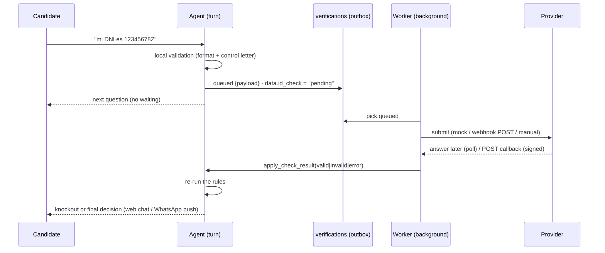

# External checks — asynchronous validation of business rules

Some hiring rules can't be decided from the conversation alone. The candidate says "12345678Z", but only an identity registry knows whether that document is real. Likewise, a background-check service answers in hours, and a recruiter must see a physical licence. These validations are **external** and **asynchronous**, and the screening must not block on them.

## Model

A profile declares `checks` (editable in *Procesos → Verificaciones externas*):

```json
{
  "id": "id_check",
  "label": {"es": "Verificación de identidad"},
  "provider": "mock_id_registry",          // mock_id_registry | webhook | manual
  "trigger": "id_document",                // a question id, or "@complete" (after the last question)
  "inputs": ["id_document", "full_name"],  // data sent to the provider
  "when": {"field": "has_license", "op": "eq", "value": true},   // optional condition
  "blocking": true,                        // hold the final decision until it answers
  "timeout_seconds": 300,
  "url": null,                             // webhook endpoint (else VERIFICATION_WEBHOOK_URL)
  "result_field": null                     // where the result is stored (default: the check id)
}
```

The result is **just data**: the field `id_check` goes `pending → valid | invalid | error`. So business rules don't need a new mechanism:

```json
{"id": "id_not_verified", "action": "disqualify", "field": "id_check", "op": "eq", "value": "invalid",
 "message": {"es": "No hemos podido verificar tu documento de identidad…"}}
```

## Lifecycle



- **During the conversation:** a result that triggers a knockout closes the screening at once, and the candidate sees the message in the chat (or on WhatsApp). Otherwise the conversation just continues.
- **At the end:** if every required answer is valid but a **blocking** check is still pending, the outcome is `verifying` ("Estoy verificando tus datos…"). When the last blocking check answers, the decision is made: `qualified`, a knockout, or `needs_review`. **Non-blocking** checks never delay the decision, but a late negative result can still trigger rules (e.g. a flag that sends the candidate to review).
- **Failure:** provider errors are retried with backoff (`VERIFICATION_MAX_ATTEMPTS`). A missed deadline becomes `error`. An `error` adds the flag `check_error:<id>`, which routes the candidate to "Por revisar". A recruiter can **retry** it or **decide** by hand; a definitive answer clears the flag.
- **Re-answers:** if the candidate's answer changes (recruiter correction, reopened question), the running verification is **superseded** and a new one is queued.

## Providers

| Provider | Behaviour |
|---|---|
| `mock_id_registry` | Local stand-in for an identity registry (demo/tests). Answers after `VERIFICATION_MOCK_DELAY_SECONDS`. Test numbers, like payment test cards: digits starting `99` → *invalid*; `98` → *error*; `97` → valid but 6× slower; anything else → *valid*. Checksum-valid examples: `12345678Z`, `99000001C`, `98000001Z`, `97000001P`. |
| `webhook` | `POST {url}` with `{"verification_id", "check", "payload", "deadline", "callback_url"}` and `X-Signature: sha256=<HMAC(body)>`. A `2xx` means accepted; if the response already contains `{"status": "valid"}`, that counts as the answer. The provider answers later with `POST /api/verifications/{id}/callback` `{"status": "valid"|"invalid"|"error", "detail"?, "reference"?}`, signed the same way. Callbacks are **rejected while `VERIFICATION_WEBHOOK_SECRET` is empty**. |
| `manual` | Nobody is called: the check appears as *Pendiente* in the candidate file and a recruiter marks it ✓ Válido / ✗ No válido. |

**Destinations are restricted.** Processes are edited by recruiters, so a webhook check may only call HTTPS hosts configured by operators: the host of `VERIFICATION_WEBHOOK_URL` plus `VERIFICATION_ALLOWED_HOSTS`. Anything else fails with an `error` and no data is sent.

Recruiters can also override any provider result from the candidate file. Every decision is audited with its author.

## Durability

Requests are written to the `verifications` table in the same transaction flow as the candidate's turn: the turn never calls the provider. A background worker (`backend/verifications/service.py`, started by the app) dispatches, polls and times out rows. Because everything is in the database, a restart loses nothing: queued and submitted checks continue on the next tick.

## Privacy (ID numbers)

- The `id_document` question is parsed **deterministically from the raw message**. The number is never sent to the LLM: the tool schema has no such field, and model output for it is ignored.
- The candidate data stores only the **masked** value (`DNI •••••678Z`) and the document type. The stored transcript is PII-redacted (`[id redacted]`, including NIE and passport patterns).
- The full number lives only in the verification **payload**. It's deleted as soon as the check has a definitive answer (kept after an `error` only so the check can be retried), and removed with the session by the retention purge.
- It never appears in the backoffice, the CSV export, the ATS summary or the events.
