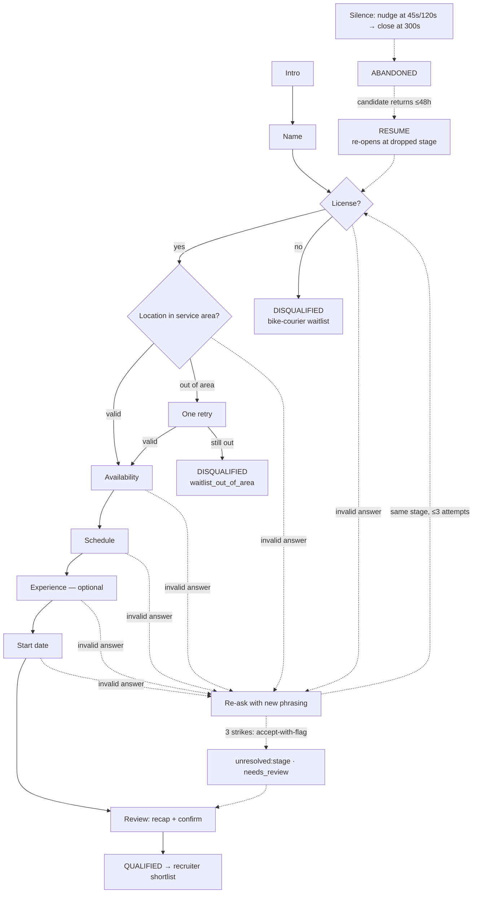

# Phase 1 — Screening Process Design

**Client:** Grupo Sazón (45 restaurants, Spain & Mexico) · **Role:** last-mile delivery courier
**Today:** 1,000 applications/week, 13 recruiters, 60% of candidates never answer the phone, 80% of recruiter time spent on unqualified candidates.
**Proposal:** a WhatsApp-style conversational screening agent ("Marisol") that pre-qualifies every candidate 24/7 in Spanish or English, and hands recruiters a structured, ranked shortlist.

## 1. Conversation stages & branching

The agent runs a deterministic stage machine. The LLM never decides the flow — it only extracts data and phrases replies. This keeps the process auditable and prevents hallucinated disqualifications.

- **LICENSE is the hard gate** — a "no" ends the driver-role screening immediately (per the brief), but the candidate is politely offered the bike-courier waitlist (per Sazón's own FAQ). Disqualifying early is the single biggest recruiter-time saving.
- **LOCATION** is validated against Sazón's 45 service areas (24 ES + 21 MX cities, with aliases and zone matching). Ambiguous matches ("León" exists in both countries) trigger one clarifying question.
- **EXPERIENCE is optional** — "no experience" is not disqualifying; it is recorded for ranking.
- **REVIEW** auto-completes when all required fields are valid: the candidate sees a compact recap and confirms.

## 2. Agent personality

- **Name/voice:** "Marisol", a warm, efficient Sazón recruiter. Conversational, never robotic.
- **One question at a time**, ≤ 2 short messages per turn (WhatsApp norm).
- **Bilingual by default:** detects the candidate's language per message, follows the candidate on switch (ES↔EN mid-conversation), keeps conversation state in the dominant language for summaries.
- **Encouraging on errors:** re-asks with a different phrasing, never blames.
- **Honest:** never invents pay figures or job promises — factual answers come only from the FAQ knowledge base (RAG), with the FAQ id logged for auditability.

## 3. Data captured & validation rules

| Field | Required | Validation |
|---|---|---|
| full_name | yes | ≥2 words, letters/spaces only, ≤80 chars |
| has_license | yes | explicit yes/no; "yes" must not be a bare "sí" to an ambiguous question |
| city / zone / country | yes | must match a Sazón service area (exact → alias → zone → fuzzy ≥0.74); ES/MX ambiguity resolved |
| availability | yes | maps to FULL_TIME / PART_TIME / WEEKENDS via ES/EN keyword sets |
| schedule | yes | MORNING / AFTERNOON / EVENING / FLEXIBLE |
| experience_years + platform | no | integer 0–40; platform free text (Glovo, Uber Eats…) |
| start_date | yes | ISO or natural ES/EN dates; must be today..+180 days |

Every field stores the raw candidate text + normalized value, so recruiters can audit the extraction.

## 4. Edge cases

- **Mid-conversation silence:** nudge at 45s, second nudge at 120s, session auto-closes as ABANDONED(silence) at 300s. Nudges are logged as events and counted in analytics (recovery rate).
- **Coming back after silence:** an abandoned session can be **resumed with its session id within 48h** (`RESUME_WINDOW_HOURS`): the candidate is welcomed back and the agent re-asks the exact question they dropped. Qualified/disqualified decisions are final and cannot be resumed.
- **Invalid/ambiguous answers:** re-ask with alternate phrasing; after 3 attempts the stage is accepted-with-flag (`unresolved:<stage>`, `needs_review`) rather than looping forever — a human reviews it.
- **Language switching:** per-message detection; MIXED answers keep the conversation language; summaries use the dominant language (ties → Spanish).
- **Qualified vs disqualified paths:** qualified → recap + confirmation + recruiter shortlist entry; disqualified → clear, respectful closure with the specific reason and (where applicable) the waitlist alternative.
- **Prompt injection / abuse / self-harm:** every message passes a guardrail layer before the LLM sees it: injection patterns → redirect, abusive language → warning (×3 → abandoned), self-harm → resources + close, PII (phone numbers) redacted before storage.
- **Post-close messages:** ignored politely (no re-screening).

## 5. Messaging tone & length

- Greetings personalized, stage questions ≤ ~120 chars, confirmations one line per field.
- No jargon, no legal language; closure messages thank the candidate explicitly.
- All templates exist in ES and EN; the LLM may rephrase a template but never changes its meaning or invents facts.
