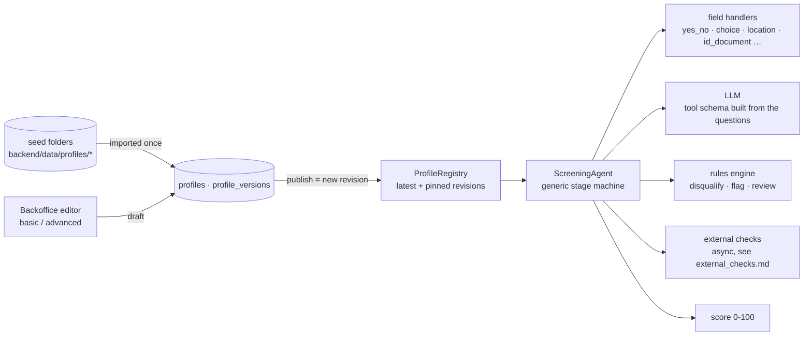

# Screening profiles — one engine, many recruiting processes

The agent is a **generic engine**. Everything that varies between recruiting processes lives in a **screening profile**:

- persona and candidate-facing messages
- questions
- business rules
- **external checks**
- scoring
- FAQ and coverage areas

Recruiters create, edit, publish and version profiles in the backoffice (*Procesos*), in an editor with a basic and an advanced mode. No code or deployment is needed.



## Lifecycle: seeds, drafts, revisions

| Concept | Meaning |
|---|---|
| **Seed** | `backend/data/profiles/<id>/profile.json` (+ optional `faq.json`, `service_areas.json`), versioned in git. On first start it's imported as **revision 1**. If a seed file changes later, it's imported as a new revision on the next start (noted "Semilla actualizada en el repositorio"). |
| **Draft** | The working copy edited in the backoffice. Each edit autosaves. Drafts may be temporarily inconsistent: each save returns every **problem with the path of the cell** to fix. Concurrent edits are detected (optimistic locking: the second save gets a conflict and is asked to reload). |
| **Publish** | Validates the draft and stores it as a new, **immutable revision**, with author and note. New candidates use it immediately, including in other app processes: the registry notices within ~2s. |
| **Pinning** | Each session stores the revision that screened it (`sessions.profile_revision`). A candidate mid-conversation finishes with the rules they started with. The candidate file and the screening report always show that revision, so every decision stays auditable. |
| **History** | Every revision can be downloaded as JSON or **restored into the draft**. |
| **Activation** | *Desactivar* hides a process from the job picker and blocks new sessions (it publishes a revision with `active: false`). Existing candidates are unaffected. |
| **Delete** | Only processes without candidates. Otherwise, deactivate. |

API: `docs/backoffice.md` (`/api/bo/profiles…`). CLI: `python scripts/validate_profiles.py [id] [--try …]` validates seed files and previews a scripted conversation.

## Editing in the backoffice

*Procesos → Editar* opens the editor. The header shows the process, the published revision, the draft state (autosaved on every change), the problem count, and the actions **Probar** (simulator), **Publicar** (asks for an optional note) and *⋯* (*Descartar borrador, Exportar JSON, Historial, Abrir chat*). Content is edited in one language at a time (ES / EN switch).

The editor has two modes. **Basic** is the default and covers what a recruiter changes day to day. **Configuración avanzada** (a switch in the header, remembered per browser) shows the technical settings as well. The switch is a UX simplification, not a permission boundary: the backoffice has no roles, and the same validation applies in both modes.

| Section | Basic mode | Advanced mode adds |
|---|---|---|
| General | role, company, job summary, assistant name, visible to candidates (active) | assistant personality and context, default language, version label, attempts per question |
| Preguntas | one card per question: name, question text, answer type, required; options as chips; *⋯* to move up/down, duplicate, delete | ID and data field, model description, alternative phrasings, type settings (threshold, min/max, start window, experience vocabulary, accepted documents), **options table** (value, text, synonyms), re-ask message per validation error |
| Reglas | each rule is a sentence: *If «data» «condition» «value» → discard / send to review / flag*, plus the message for the candidate (knockouts) and a recruiter note. New rules get a name and id from their condition | ID, name, trigger (a data value / a validation error with retries), flags |
| Puntuación | each criterion is a sentence (*«points» if «data» «condition» «value»*, or *per unit* via its *⋯* menu), with the achievable total | criterion name |
| Verificaciones externas | — (hidden) | ID, name, provider, triggering question, blocking, deadline, data sent (sensitive ones marked), "only if" condition, webhook URL, result field |
| Mensajes | greeting and closings (qualified / review, and verifying when the process has checks) | resume, hand-back, paused, reminders |
| Preguntas frecuentes | question and answer per language | — |
| Zonas de trabajo | city, country, other names, districts/towns | — |
| Historial de versiones | revisions with author, note and candidates screened; download / *Restaurar al borrador* | — |
| **Probar** (drawer) | **simulator**: chat against the draft (or published) rules with the deterministic engine; shows status, score, alerts and data. External checks answer instantly using the mock registry test numbers. Nothing is stored. | — |

Problems (e.g. a rule that uses a deleted question) are listed under the header with an "ir →" link that jumps to the field; the field is outlined in red and its section is marked in the left menu. Publishing is disabled until there are none.

## Anatomy of a profile (JSON)

```jsonc
{
  "id": "construction_laborer",            // stable id: stored on every session, never renamed
  "version": "2026-12",                     // free label; the revision number is assigned on publish
  "active": true,
  "company": "Constructora Horizonte",
  "role": {"es": "Peón / ayudante de obra", "en": "Construction labourer / site helper"},
  "summary": {"es": "…", "en": "…"},
  "persona": {"agent_name": "Andrés", "personality": "…", "context": "…"},
  "languages": ["es", "en"], "default_language": "es",
  "intro": {"es": ["¡Hola! Soy {name}, de Constructora Horizonte …"], "en": ["…"]},
  "messages": {"qualified": {…}, "review": {…}, "verifying": {…}, "resume": {…}, "reengage": {"1": {…}, "2": {…}},
               "handback": {…}, "paused": {…}},
  "questions": [ … ],
  "rules": [ … ],
  "checks": [ … ],
  "scoring": [ … ],
  "faq": [{"id": "pay_es", "lang": "es", "q": "…", "a": "…"}],      // seeds may use "faq_file" instead
  "service_areas": [{"city": "Madrid", "country": "ES", "aliases": [], "zones": ["Getafe"]}],  // or "service_areas_file"
  "max_stage_attempts": 3
}
```

Unknown keys are rejected (typos like `requierd` are reported). Texts are localised dicts, with Spanish as the fallback. Prompts accept `{name}`, `{company}` and `{role}`.

## Questions

Each question is one conversation stage. `id` is the stage name shown in analytics; `field` is the data key stored for the candidate.

| `type` | Stores | Settings | Error codes (re-ask messages) |
|---|---|---|---|
| `name` | full name (≥2 words) | — | `empty`, `placeholder`, `format`, `single_word` |
| `yes_no` | `true`/`false` | `number_threshold` ("tengo 17" → false when 18) | `unclear_yes_no` |
| `choice` | one option value | `options: [{value, label, keywords}]` | `unknown_option` |
| `multi_choice` | list of option values | same | `unknown_option` |
| `number` | number | `min`, `max` | `unparsed_number`, `range` |
| `experience` | years (+ tags list) | `min`, `max`, `tags` (term → synonyms), `tags_field` | `unparsed_years`, `range` |
| `date` | ISO date | `max_days_ahead` | `unparsed_date`, `past_date`, `too_far` |
| `location` | city + `zone`, `country`, `in_service_area` | coverage from `service_areas` (any city if empty) | `ambiguous_city`, `out_of_area` |
| `text` | free text | — | `empty` |
| `id_document` | **masked** number + `<field>_type` (dni/nie/passport) | `documents` accepted | `invalid_id`, `invalid_id_checksum` |

`id_document` is **sensitive**. It's parsed from the raw message, never through the LLM. DNI/NIE control letters are validated locally, only a masked value is stored, and the full number travels only to an external check (see `docs/external_checks.md`).

Keywords match case- and accent-insensitively on whole words. Every type has a deterministic parser, so every profile works without a model server (and in the simulator).

## Business rules

```json
{"id": "underage", "action": "disqualify", "label": {"es": "Menor de 18 años"},
 "field": "is_adult", "op": "eq", "value": false, "message": {"es": "…", "en": "…"}}

{"id": "out_of_area", "action": "disqualify", "on_error": "out_of_area", "question": "location",
 "after_attempts": 1, "flags": ["waitlist_out_of_area"], "message": {"es": "…"}, "label": {…}}

{"id": "physical_review", "action": "flag", "field": "physical_ok", "op": "eq", "value": false,
 "flags": ["physical_review"], "review": true, "note": "…", "label": {…}}

{"id": "id_not_verified", "action": "disqualify", "field": "id_check", "op": "eq", "value": "invalid",
 "message": {"es": "…"}, "label": {…}}
```

- **Triggers:** a condition on any data key (answers *and* external check results) with operators `eq ne lt lte gt gte in not_in contains not_contains missing present within_days`, or a validation error on a question after N failed attempts.
- **Effects:** `disqualify` closes the screening with the candidate message. `flag` adds alerts and a note; with `review: true`, an otherwise qualified candidate goes to "Por revisar".
- **When rules run:** after every candidate turn, and again whenever an external check answers.

Qualification = no knockout matched, every required question validly answered, and no **blocking** check still pending (otherwise the outcome is `verifying`).

## External checks

Declared per profile, answered asynchronously by a provider (`mock_id_registry`, `webhook`, `manual`). The result lands in a data field that rules use. Full design: `docs/external_checks.md`.

## Scoring

The score ranks candidates *inside* a process (0-100, normalised by the best achievable score); it never decides qualification. Conditional criteria award `points` (alternatives on the same field: the largest counts towards the maximum). `per_unit` criteria award points per unit or item, capped by `max_points`. Recruiter corrections re-score immediately.

## Worked example: the low-qualification construction process

| Need | Profile design |
|---|---|
| No formal requirements: don't lose people without experience | Experience and PRL course are optional and only add score. |
| Legal requirements | `underage` and `no_work_permit` are knockouts with respectful messages. |
| Identity must be real (contract, social security) | `id_document` question (DNI/NIE/passport, control letter checked locally) + **blocking** `id_check` against the identity registry; `id_not_verified` knockout; registry failures go to review. |
| Minimum personal data | Age is yes/no (`number_threshold: 18`); the ID is masked in the data, redacted in the transcript, purged from the check payload once answered. |
| Physical capability is sensitive | `physical_review` is a flag with `review: true`: a human decides, never an automatic rejection. |
| Missing training is fixable | `needs_prl_training` flag with a recruiter note. |
| Sites move, early starts | `transport` choice with its own score; no transport is a flag. |
| Readers on a phone, limited literacy | Very short sentences, yes/no and simple options, bilingual. |
| Site coverage | Coverage areas; out of area → one retry → waitlist. |

The courier process shows the other check style: a **manual, non-blocking** `license_check`, requested only `when` the candidate says they have a licence. A recruiter confirms it later, and a negative result flags the candidate for review.

## Adding a process

In the backoffice: *Procesos → Nuevo proceso* (minimal template) or *Duplicar* an existing one. Edit questions and rules, try it in *Probar*, then *Publicar*. It appears in the job picker (`/?job=<id>`) and everywhere else at once.

As code (seed), for processes that should live in the repository: add `backend/data/profiles/<id>/profile.json`, run `python scripts/validate_profiles.py <id> --try "hola" …`, and restart. Keep ids and fields stable once candidates exist; add new ones instead of renaming.
